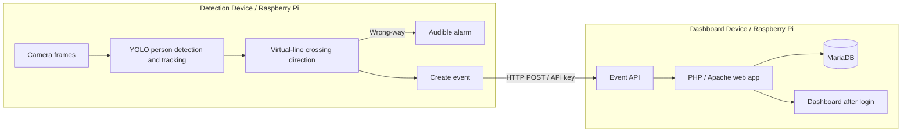
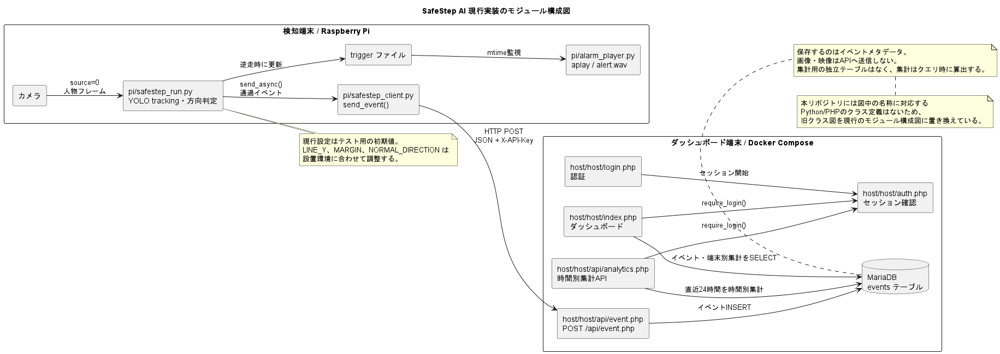

<div align="center">

# SafeStep AI

### Wrong-Way Stair Traffic Detection and Audible Warning System

A graduation project prototype that uses YOLO on Raspberry Pi to infer stair traffic direction and provide an audible warning when wrong-way movement is detected.

[日本語](README.md) · [System Architecture](#system-architecture) · [Research Overview](#research-overview) · [Setup](#setup)

</div>

---

## Overview

SafeStep AI is a prototype system intended to estimate pedestrian travel direction on school stairways from camera input and detect movement opposite to a configured normal direction. A detection device uses YOLO-based person detection and tracking to identify crossings of a virtual line. When a crossing is classified as wrong-way movement, the device plays an audible warning and sends an event to a separate dashboard over an HTTP API.

This repository contains the detection client, a web dashboard/API, and database deployment files. The project is under development; it does not guarantee detection accuracy or operational safety in real environments.

## Research Overview

| Item | Description |
| --- | --- |
| Background | Stairways may have designated travel directions, creating a need to notify people when movement is against the intended flow. |
| Objective | Build a prototype that estimates crossing direction from camera input, provides an audible warning for wrong-way movement, and records detection events. |
| Method | Run YOLO-based person detection and tracking on Raspberry Pi, then infer direction from the order in which a track crosses a virtual line. |
| Output | An audible warning on the detection device and event information accessible from a web dashboard. Video frames are not sent to the event API. |
| Evaluation status | No quantitative experimental results are reported in this README. Evaluation requires defined installation and camera conditions. |

## System Architecture



Detection and the web application/database run separately. The dashboard device runs the web service and MariaDB using Docker Compose.

## Processing Pipeline

1. Capture frames from the camera.
2. Detect and track people with YOLO.
3. Estimate travel direction when a person crosses the virtual line.
4. Compare the direction with the configured normal direction and play an alarm for a wrong-way crossing.
5. Send the device name, event time, track ID, direction, and wrong-way flag to the event API.
6. Store the event in the web application for authenticated dashboard viewing and aggregation.

## Features

- Real-time person detection and tracking with YOLO
- Direction estimation based on virtual-line crossings
- Audible alarm on the detection Raspberry Pi
- Event submission protected by an API key
- Login-protected web dashboard and event aggregation
- Docker Compose deployment for PHP / Apache and MariaDB

## Technology and Hardware

| Category | Technology / Hardware |
| --- | --- |
| Edge devices | Raspberry Pi 5, Raspberry Pi OS 64-bit / ARM64 |
| Input and alert | USB / web camera, speaker |
| Detection | Python, Ultralytics YOLO, OpenCV (camera processing) |
| Web | PHP 8.3, Apache |
| Database | MariaDB 11.4 |
| Deployment | Docker Engine, Docker Compose plugin |

## Repository Structure

```text
.
├── docs/
│   ├── class_diagram.png       # Initial design class diagram
│   └── class_diagram.puml      # PlantUML source
├── host/
│   ├── database/               # Database initialization SQL
│   ├── host/                   # Web application and API
│   ├── compose.yaml            # Docker Compose configuration
│   └── README.md               # Dashboard setup and operation guide
├── pi/                         # Detection client, startup, and audio scripts
├── CONTRIBUTING.md
├── LICENSE
├── README.md                   # Japanese
└── README.en.md                # English
```

## Design Reference

The image below is a conceptual class diagram from the initial design. Some parts differ from the current implementation, so it is provided as a design reference rather than a complete diagram of the implemented classes.

<p align="center">
  
</p>

## Setup

### Dashboard Device

Prepare Raspberry Pi OS 64-bit / ARM64, Docker Engine, and the Docker Compose plugin. See [`host/README.md`](host/README.md) for credential configuration, database migration, startup, and backup instructions.

```bash
cd host
cp .env.example .env
# Configure credentials and API keys in .env
# Prepare private/config.php (see host/README.md)
docker compose up -d --build
```

After startup, open `http://<dashboard-device-IP>:8080/` in a browser. Do not commit `.env` to Git.

### Detection Device

Copy the scripts in `pi/` and the required YOLO model to the detection Raspberry Pi. Set the API endpoint in `pi/start_safestep.sh` to the actual dashboard device address. Configure the API key on first launch, then verify the camera and audio output.

The detection code values `LINE_Y`, `MARGIN`, and `NORMAL_DIRECTION` must be adjusted for the installation. Fix and document the camera orientation, field of view, resolution, and virtual-line location, then test on the actual stairway before use. Refer to [`host/README.md`](host/README.md) for detailed dashboard deployment and operation instructions.

## Evaluation Plan and Limitations

When reporting experimental results, record at least the following conditions and metrics, and publish measured values in this README or a separate report. No performance figures that cannot be verified from the current repository are stated here.

- **Detection and classification:** number of trials in each direction, correct detections, missed detections, and false alarms
- **Responsiveness:** delay from line crossing to alarm and event API submission
- **Test conditions:** camera model/resolution/position, lighting, crowding, walking speed, and number of trials
- **Operational behavior:** behavior during network outages, restarts, and long-duration operation

Performance may be affected by camera angle, virtual-line placement, occlusion, lighting, and track-ID stability. False positives and missed detections are possible; this prototype is not a replacement for physical safety measures or staff supervision.

## Privacy and Operational Notes

- The system is not intended for face recognition or personal identification.
- The detection client sends event metadata, not video, to the event API. Confirm the facility's rules and applicable privacy requirements before installation.
- Do not share or commit `.env` files, API keys, or login credentials.
- Do not expose the dashboard directly to the internet over its default HTTP configuration. Use it on a LAN or through a VPN.
- Back up the database regularly and verify the restore procedure.

## Development and License

See [`CONTRIBUTING.md`](CONTRIBUTING.md) for the development workflow and [`LICENSE`](LICENSE) for license terms. This graduation project is under active development.
