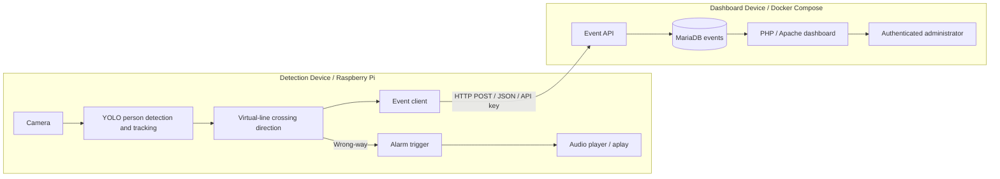

<div align="center">

# SafeStep AI

### Wrong-Way Stair Traffic Detection and Audible Warning System

A graduation-project prototype that estimates stair traffic direction from camera input, detects wrong-way crossings, and records events for review.

[日本語](README.md) · [Research Overview](#research-overview) · [Architecture](#system-architecture) · [Setup](#setup)

</div>

---

## Project Overview

SafeStep AI is a prototype for school stairways. A Raspberry Pi detects and tracks people, estimates their crossing direction against a configured normal direction, and triggers an audible warning for wrong-way movement. Detection events are sent to a separate web dashboard for storage and review.

> **This is an experimental graduation project, not a certified safety system.** It does not guarantee accuracy or safety and must not replace facility safety measures, signage, or staff supervision.

## Research Overview

| Item | Description |
| --- | --- |
| Background | Where stairways have designated travel directions, it can be useful to make movement against that direction more noticeable. |
| Objective | Build a prototype that estimates crossing direction, provides an audible warning for wrong-way movement, and records detection events. |
| Approach | Run Ultralytics YOLO person detection and tracking on Raspberry Pi, then infer direction from a person's crossing of a virtual line. |
| Output | An audible alert on the detection device and event information in a web dashboard. Video itself is not sent to the event API. |
| Evaluation status | This README does not claim measured accuracy or performance figures. Evaluation under documented deployment conditions remains necessary. |

## System Architecture



The detection process and the dashboard/database can run on separate devices. The web services are deployed with Docker Compose.

## Detection and Event Flow

1. The detection device captures camera frames and detects/tracks people.
2. It uses the bounding-box center Y coordinate and virtual-line settings to determine which side of the line a track occupies.
3. When a track crosses the line, the system determines the direction (`UP` or `DOWN`).
4. A crossing opposite to the configured normal direction creates a wrong-way event and triggers local audio playback.
5. The client sends the device name, detection time, track ID, direction, and wrong-way flag to the event API.
6. The API validates the input and inserts the event into MariaDB's `events` table.
7. An authenticated administrator reviews events and aggregates in the dashboard.

### Current Implementation Notes

- Detection and direction logic: [`pi/safestep_run.py`](pi/safestep_run.py). Event client: [`pi/safestep_client.py`](pi/safestep_client.py).
- The current model path is `/workspace/yolo26n_ncnn_model`. Initial direction settings are `LINE_Y=240`, `MARGIN=20`, and `NORMAL_DIRECTION="DOWN"`; these are provisional and must be calibrated for the installation.
- The initial reverse threshold is one reverse crossing within a 30-second window. [`pi/alarm_player.py`](pi/alarm_player.py) plays [`alert.wav`](pi/warning_audio/alert.wav) and coalesces triggers received during playback.
- Tracking uses Ultralytics YOLO's `model.track(..., persist=True)`; the current code does not implement a separate SORT tracker.
- Event submission has a timeout but no persistent queue or retry guarantee. Events may be lost during network failures.

## Dashboard

The current authenticated dashboard provides:

- Total events, reverse events, and reverse-event rate
- Per-device event counts, reverse counts, and most recent event time
- The latest 50 events
- Hourly aggregation for the most recent 24 hours
- Automatic page refresh every five seconds

Aggregates are calculated from event records when queried; no separate statistics table is used.

## Technology and Hardware

| Area | Technology / Hardware |
| --- | --- |
| Detection device | Raspberry Pi 5, Raspberry Pi OS 64-bit / ARM64 |
| Imaging and audio | USB / web camera, speaker, `aplay` |
| Detection and tracking | Python, Ultralytics YOLO, OpenCV (camera input) |
| Web application | PHP 8.3, Apache |
| Database | MariaDB 11.4 |
| Deployment | Docker Engine, Docker Compose plugin |

## Repository Structure

```text
.
├── docs/                         # Requirements, design documents, architecture diagram
├── host/                         # Web app/API, Compose, database initialization SQL
│   └── README.md                 # Dashboard deployment and operation guide
├── pi/                           # Detection, event client, and audio scripts
├── CONTRIBUTING.md               # Development workflow
├── LICENSE
├── README.md                     # Japanese
└── README.en.md                  # English
```

## Setup

### 1. Dashboard Device

Prepare Raspberry Pi OS 64-bit / ARM64, Docker Engine, and the Docker Compose plugin. See [`host/README.md`](host/README.md) for credential setup, `private/config.php`, database migration, startup, and backup instructions.

```bash
cd host
cp .env.example .env
# Replace credentials and API keys in .env
# Prepare private/config.php (see host/README.md)
docker compose up -d --build
```

After startup, open `http://<dashboard-device-IP>:8080/`. Never commit `.env` or credentials to Git.

### 2. Detection Device

Deploy the scripts in `pi/` and the required YOLO model to the detection Raspberry Pi. Set the dashboard address in [`pi/start_safestep.sh`](pi/start_safestep.sh), configure the API key, and verify camera and audio access. Confirm the expected deployment layout and model path, then calibrate `LINE_Y`, `MARGIN`, and `NORMAL_DIRECTION` for the camera view.

> Test in a controlled environment first. Do not expose the dashboard's HTTP service directly to the public internet.

## Design and Project Documents

- [Software requirements specification](docs/requirements-specification.md)
- [Database design](docs/database-design.md)
- [Project plan](docs/project-plan.md)
- [Current implementation architecture (PlantUML)](docs/class_diagram.puml)
- [Dashboard deployment and operation guide](host/README.md)
- [Contribution guidelines](CONTRIBUTING.md)

The PlantUML file describes the current script/API module layout; it is not the earlier conceptual class diagram.

## Evaluation and Limitations

When reporting performance, separate targets from measured results and document the test conditions and number of trials. Recommended measurements include:

- Trial counts, correct detections, missed detections, and false detections in each direction
- Delay from line crossing to alarm playback and API registration
- Camera model/resolution/position, lighting, crowding, occlusion, and walking speed
- Behavior during network outages, restarts, and long-duration operation

Results depend on camera angle, virtual-line placement, lighting, occlusion, and tracking stability. False positives and missed detections are possible, so this prototype is not a substitute for safety measures or staff supervision.

## Privacy and Operations

- The event API receives event metadata, not camera video. Confirm facility rules and applicable privacy requirements before deployment.
- The system is not intended for face recognition or personal identification. Track IDs are used for event processing and aggregation.
- Do not share or commit `.env`, API keys, database passwords, or login credentials.
- The current Compose setup serves HTTP. Keep it on a trusted LAN or use a VPN; do not expose it directly to the internet.
- Back up the database regularly and verify restoration. `docker compose down -v` deletes the database volume.

## Team

- [TatsuyaTakigawa](https://github.com/TatsuyaTakigawa)
- [Ryo7018](https://github.com/Ryo7018)
- [kousukesaburi](https://github.com/kousukesaburi)
- [mukai-bot](https://github.com/mukai-bot)

## Reference and License

- README structure and presentation reference: [note article](https://note.com/yukikkoaimanabi/n/n587aa648e0f9#809c1104-0bf1-4e3c-b4d2-13aa54cd37c2)
- License: [MIT License](LICENSE)
