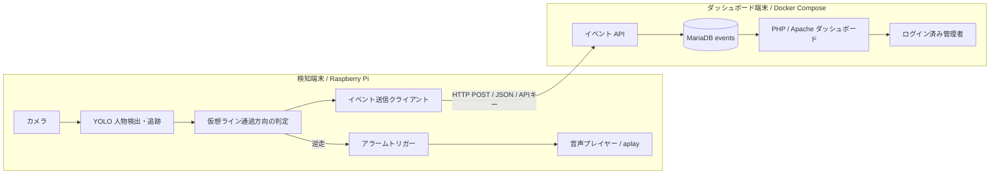

<div align="center">

# SafeStep AI

### 学校階段の逆走検知・音声注意喚起システム

**カメラ映像から通過方向を推定し、逆走イベントを検知・記録する卒業制作プロトタイプ**

[English](README.en.md) · [研究概要](#研究概要) · [システム構成](#システム構成) · [セットアップ](#セットアップ)

</div>

---

## プロジェクト概要

SafeStep AI は、学校階段での通行方向をカメラ映像から判定し、設定された通常方向と逆向きの通過を検知した際に音声で注意を促す試作システムです。検知端末で人物を検出・追跡し、通過イベントを別端末の Web ダッシュボードへ送信します。

> **開発中の研究・制作プロトタイプです。** 検知精度や安全性を保証するものではなく、施設の安全設備・掲示・人員による管理の代替として使用しないでください。

## 研究概要

| 項目 | 内容 |
| --- | --- |
| 背景 | 階段に一方向通行のルールがある環境では、逆方向の通行に気づきやすくする方法が課題になります。 |
| 目的 | 人物の通過方向を推定し、逆走時の音声注意喚起とイベント記録を行うシステムを試作すること。 |
| アプローチ | Raspberry Pi 上で Ultralytics YOLO の人物検出・追跡を実行し、仮想ラインの通過方向を判定します。 |
| 出力 | 検知端末での音声再生と、Web ダッシュボードで閲覧できるイベント情報です。映像そのものはイベント API に送信しません。 |
| 評価状況 | README に検証済みの精度・速度等の数値結果は掲載していません。実機・設置条件を定めた評価が必要です。 |

## システム構成



検知処理とダッシュボード／データベースは分離して動作できます。Web 側は Docker Compose で PHP / Apache と MariaDB を起動します。

## 検知・記録の流れ

1. 検知端末がカメラ映像から人物を検出し、トラッキングします。
2. バウンディングボックス中心の Y 座標と仮想ライン設定を使って、ラインの上側／下側を判定します。
3. 同じ追跡 ID の位置がラインをまたいだ場合、通過方向（`UP` / `DOWN`）を決定します。
4. 通常方向と異なる場合は逆走イベントを生成し、音声再生のトリガーを発行します。
5. 端末名、検知時刻、追跡 ID、方向、逆走フラグをイベント API へ送信します。
6. API が入力を検証し、イベントを MariaDB の `events` テーブルに保存します。
7. ログイン済み管理者がダッシュボードでイベントと集計を確認します。

### 現行実装の設定と制約

- 検知処理は [`pi/safestep_run.py`](pi/safestep_run.py)、イベント送信は [`pi/safestep_client.py`](pi/safestep_client.py) にあります。
- モデルパスは `/workspace/yolo26n_ncnn_model`、方向判定の初期値は `LINE_Y=240`、`MARGIN=20`、`NORMAL_DIRECTION="DOWN"` です。設置環境に合わせて調整する必要があります。
- 逆走カウントの初期設定は30秒間に1件でアラームトリガーを発行する値です。音声プレイヤー [`pi/alarm_player.py`](pi/alarm_player.py) は [`alert.wav`](pi/warning_audio/alert.wav) を再生し、再生中の追加トリガーをまとめます。
- トラッキングは Ultralytics YOLO の `model.track(..., persist=True)` を使用しています。独立した SORT 実装ではありません。
- イベント送信はタイムアウト付きですが、永続キューや再送保証はありません。通信障害時にイベントが記録されない可能性があります。

## ダッシュボード

ログイン後、現行の Web アプリでは次の情報を確認できます。

- イベント総数、逆走件数、逆走率
- 端末ごとのイベント数、逆走数、最終イベント時刻
- 最新イベント（最大50件）
- 直近24時間の時間別集計
- 画面の5秒ごとの自動更新

集計値はイベントレコードから取得時に計算し、独立した統計テーブルには保存しません。

## 使用技術

| 領域 | 技術・機材 |
| --- | --- |
| 検知端末 | Raspberry Pi 5、Raspberry Pi OS 64-bit / ARM64 |
| 映像・音声 | USB / Web カメラ、スピーカー、`aplay` |
| 検知・追跡 | Python、Ultralytics YOLO、OpenCV（カメラ入力） |
| Web アプリ | PHP 8.3、Apache |
| データベース | MariaDB 11.4 |
| 配備 | Docker Engine、Docker Compose plugin |

## リポジトリ構成

```text
.
├── docs/                         # 要求・設計文書、システム構成図
├── host/                         # Webアプリ/API、Compose、DB初期化SQL
│   └── README.md                 # ダッシュボードの構築・運用手順
├── pi/                           # 検知・イベント送信・音声関連スクリプト
├── CONTRIBUTING.md               # 開発ルール
├── LICENSE
├── README.md                     # 日本語
└── README.en.md                  # English
```

## セットアップ

### 1. ダッシュボード端末

Raspberry Pi OS 64-bit / ARM64、Docker Engine、Docker Compose plugin を用意してください。認証情報の作成、`private/config.php`、DB 移行・バックアップを含む詳細手順は [`host/README.md`](host/README.md) を参照してください。

```bash
cd host
cp .env.example .env
# .env の認証情報・APIキーを必ず置き換える
# private/config.php を用意（host/README.md を参照）
docker compose up -d --build
```

起動後、`http://<ダッシュボード端末のIPアドレス>:8080/` を開きます。`.env` や認証情報を Git に登録しないでください。

### 2. 検知端末

`pi/` の検知スクリプトと必要な YOLO モデルを検知用 Raspberry Pi に配置します。[`pi/start_safestep.sh`](pi/start_safestep.sh) のダッシュボード接続先を環境に合わせて設定し、カメラ、音声出力、API キーを確認してください。起動時に期待される配置・モデルパスも確認し、`LINE_Y`、`MARGIN`、`NORMAL_DIRECTION` を実際のカメラ画角に合わせて調整します。

> 初回はテストデータと管理された環境で確認してください。HTTP のダッシュボードをインターネットへ直接公開しないでください。

## 設計資料・開発文書

- [要求仕様書](docs/requirements-specification.md)
- [データベース設計書](docs/database-design.md)
- [プロジェクト計画書](docs/project-plan.md)
- [現行実装のシステム構成図（PlantUML）](docs/class_diagram.puml)
- [ダッシュボード構築・運用手順](host/README.md)
- [開発ルール](CONTRIBUTING.md)

PlantUML は現行のスクリプト/API構成を示すモジュール構成図です。以前のクラス設計図とは異なります。

## 評価計画と限界

性能を報告する際は、目標値と実測値を分け、試験条件と試行数を併記してください。少なくとも次を記録することを推奨します。

- 正方向・逆方向それぞれの試行数、正検知、見逃し、誤検知
- ライン通過からアラーム開始まで、および API 登録までの遅延
- カメラ機種・解像度・設置位置、照明、混雑、遮蔽、歩行速度
- ネットワーク切断、再起動、長時間稼働時の挙動

画角、仮想ライン、照明、遮蔽、トラッキングの安定性により結果は変わります。誤検知・見逃しの可能性があるため、安全設備や人員の代替にはなりません。

## プライバシー・運用上の注意

- イベント API が受け取るのはイベントメタデータであり、カメラ映像ではありません。設置前に施設のルールとプライバシー要件を確認してください。
- 顔認識や個人特定を目的とするシステムではありません。追跡 ID はイベント処理・集計に使用されます。
- `.env`、API キー、DB パスワード、ログイン情報を共有・コミットしないでください。
- 現行 Compose は HTTP で公開します。LAN 内または VPN 経由で利用し、インターネットへ直接公開しないでください。
- DB を定期バックアップし、復元可能であることを確認してください。`docker compose down -v` は DB ボリュームを削除します。

## チームメンバー

- [TatsuyaTakigawa](https://github.com/TatsuyaTakigawa)
- [Ryo7018](https://github.com/Ryo7018)
- [kousukesaburi](https://github.com/kousukesaburi)
- [mukai-bot](https://github.com/mukai-bot)

## 参考・ライセンス

- ライセンス：[MIT License](LICENSE)
