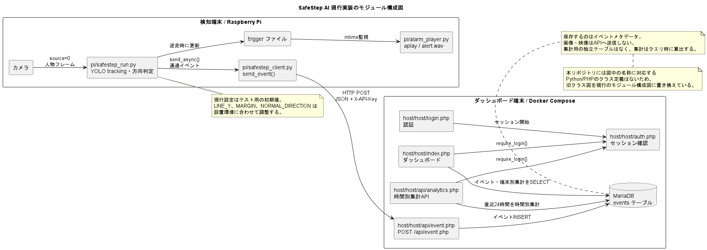

# SafeStep AI

学校内階段における逆走検知システム

---

# 概要

SafeStep AI は、学校内階段における逆走行為をリアルタイムで検知し、音声アナウンスによって注意喚起を行う AI システムです。

本システムは Raspberry Pi 上で動作し、YOLO による人物検出および SORT による人物追跡を組み合わせることで、階段内の通行方向を判定します。

卒業制作プロジェクトとして開発されています。

---

# 主な機能

* YOLO を用いたリアルタイム人物検出
* SORT による人物追跡
* 逆走検知
* 音声アナウンスによる警告
* ログ記録
* Web ダッシュボード
* Raspberry Pi ベースの分散構成

---

# システム構成

```text id="j1f9pv"
カメラ
   ↓
人物検出（YOLO）
   ↓
人物追跡（SORT）
   ↓
逆走判定
   ↓
音声アナウンス
   ↓
ログ記録 / 管理画面
```

---

# クラス図

システムを構成する主要クラスとその関係を示します。



---

# 使用技術

## ハードウェア

* Raspberry Pi 5
* USB / Web カメラ
* スピーカー

## ソフトウェア

* Python 3.x
* YOLOv8
* SORT
* OpenCV
* Flask
* SQLite
* Cron

---

# ディレクトリ構成

```text id="mtfmy8"
safestep-ai/
│
├── app/
│   ├── detection/
│   ├── tracking/
│   ├── violation/
│   ├── audio/
│   ├── dashboard/
│   └── utils/
│
├── config/
├── docs/
├── logs/
├── models/
├── tests/
│
├── main.py
├── requirements.txt
├── README.md
└── LICENSE
```

---

# セットアップ

## リポジトリの取得

```bash id="x8guxs"
git clone https://github.com/your-name/safestep-ai.git
cd safestep-ai
```

## 仮想環境の作成

```bash id="49a5dj"
python -m venv .venv
```

## 仮想環境の有効化

### Windows

```bash id="g3i42f"
.venv\Scripts\activate
```

### Linux / Raspberry Pi

```bash id="ls1v5x"
source .venv/bin/activate
```

## 必要ライブラリのインストール

```bash id="wdn7mt"
pip install -r requirements.txt
```

---

# 実行方法

```bash id="2s46lm"
python main.py
```

---

# プライバシーポリシー

SafeStep AI はプライバシー保護を重視しています。

* 映像データの保存は行いません
* 顔認識は行いません
* 個人識別情報は保存しません
* ログには個人情報を含みません

本システムはリアルタイム処理のみを目的としています。

---

# 開発ルール

* `main` ブランチへの直接 push を禁止
* `feature/*` ブランチで開発
* Pull Request ベースで統合

---

# ライセンス

本プロジェクトは MIT License のもとで公開しています。

---

# 開発状況

現在開発中。

2026〜2027 年度 卒業制作プロジェクト。
