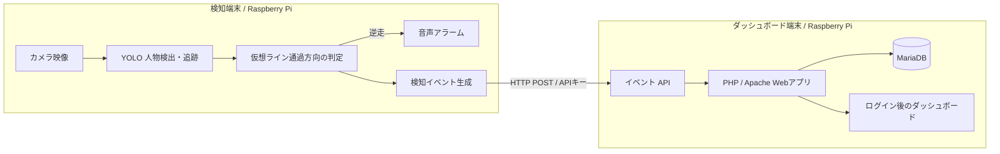

<div align="center">

# SafeStep AI

### 学校階段における逆走検知・注意喚起システム

Raspberry Pi と YOLO を用いて階段の通行方向を判定し、逆走を検知した際に音声で注意喚起する卒業制作プロジェクトです。

[English](README.en.md) · [システム構成](#システム構成) · [研究概要](#研究概要) · [セットアップ](#セットアップ)

</div>

---

## 概要

SafeStep AI は、学校内の階段を対象に、カメラ映像から人物の通過方向を推定し、設定された通常方向と異なる通行を検知することを目指すシステムです。検知端末は YOLO の人物検出・追跡を用いて仮想ラインの通過を判定します。逆走と判定した場合は端末側で音声アラームを鳴らし、検知イベントを HTTP API 経由でダッシュボードへ送信します。

本リポジトリには、検知クライアント、Web ダッシュボード/API、データベースを含む試作システムを収録しています。システムは開発中であり、実環境における認識精度や安全性を保証するものではありません。

## 研究概要

| 項目 | 内容 |
| --- | --- |
| 背景 | 階段では通行方向のルールが設けられる場合があり、逆方向の通行への注意喚起が必要となることがあります。 |
| 目的 | カメラ映像を用いて人物の通過方向を判定し、逆走時の音声注意喚起とイベント記録を行う試作システムを構築すること。 |
| 方法 | Raspberry Pi 上で YOLO による人物検出・追跡を行い、画面上の仮想ラインをまたぐ順序から方向を判定します。 |
| 出力 | 検知端末での音声アラームと、Web ダッシュボードで参照するイベント情報。映像そのものはイベント API に送信しません。 |
| 評価状況 | 本 README では定量的な実験結果を提示していません。評価は設置環境・カメラ条件を定めたうえで実施する必要があります。 |

## システム構成



検知処理と Web アプリ／データベースは分離して動作します。ダッシュボード側は Docker Compose で Web サービスと MariaDB を起動します。

## 処理の流れ

1. カメラからフレームを取得します。
2. YOLO が人物を検出し、フレーム間で追跡します。
3. 人物の位置が仮想ラインを越えたとき、通過方向を推定します。
4. 設定された通常方向と比較し、逆走と判定された場合はアラームを鳴らします。
5. 端末名、検知時刻、追跡 ID、方向、逆走フラグをイベント API に送信します。
6. Web アプリがイベントを保存し、ログイン済みユーザー向けに表示・集計します。

## 主な機能

- YOLO によるリアルタイムの人物検出・追跡
- 仮想ライン通過に基づく方向判定
- 逆走検知時の端末側音声アラーム
- API キーを用いたイベント送信
- ログイン保護された Web ダッシュボードとイベント集計
- Docker Compose による PHP / Apache と MariaDB の構成

## 使用技術・機材

| 分類 | 使用技術・機材 |
| --- | --- |
| エッジ端末 | Raspberry Pi 5、Raspberry Pi OS 64-bit / ARM64 |
| 入力・通知 | USB / Web カメラ、スピーカー |
| 検知 | Python、Ultralytics YOLO、OpenCV（カメラ処理） |
| Web | PHP 8.3、Apache |
| データベース | MariaDB 11.4 |
| 配備 | Docker Engine、Docker Compose plugin |

## リポジトリ構成

```text
.
├── docs/
│   ├── class_diagram.png       # 初期設計のクラス図
│   └── class_diagram.puml      # PlantUML ソース
├── host/
│   ├── database/               # DB 初期化 SQL
│   ├── host/                   # Web アプリと API
│   ├── compose.yaml            # Docker Compose 構成
│   └── README.md               # ダッシュボードの構築・運用手順
├── pi/                         # 検知クライアント、起動・音声関連スクリプト
├── CONTRIBUTING.md
├── LICENSE
├── README.md                   # 日本語
└── README.en.md                # English
```

## セットアップ

### ダッシュボード端末

Raspberry Pi OS 64-bit / ARM64 と Docker Engine、Docker Compose plugin を用意してください。`host/README.md` には認証情報の設定、データベース移行、起動、バックアップに関する詳細があります。

```bash
cd host
cp .env.example .env
# .env の認証情報・APIキーを環境に合わせて設定
# private/config.php を用意（host/README.md を参照）
docker compose up -d --build
```

起動後、ブラウザーから `http://<ダッシュボード端末のIPアドレス>:8080/` にアクセスします。`.env` は Git に登録しないでください。

### 検知端末

`pi/` のスクリプトと必要な YOLO モデルを検知用 Raspberry Pi に配置します。`pi/start_safestep.sh` 内の API 接続先は、実際のダッシュボード端末のアドレスに合わせて設定してください。初回起動時に API キーを設定し、カメラと音声出力を確認してください。

検知コード内の `LINE_Y`、`MARGIN`、`NORMAL_DIRECTION` は設置環境に応じて調整する値です。カメラの向き・画角・解像度・ライン位置を固定し、実際の階段でテストしてから利用してください。ダッシュボードの詳細な構築・運用方法は [`host/README.md`](host/README.md) を参照してください。

## 評価計画と限界

実験結果を報告する際は、少なくとも以下の条件・指標を記録し、README や別の報告書に実測値を記載してください。本リポジトリの現状から確認できない性能数値は記載していません。

- **検出・判定性能:** 正方向／逆方向それぞれの試行数、正検知数、見逃し数、誤警報数
- **応答性:** ライン通過からアラームまで、およびイベント API への送信までの遅延
- **試験条件:** カメラ機種・解像度・設置位置、照明、混雑度、歩行速度、試験回数
- **運用性:** ネットワーク切断時、再起動時、長時間動作時の挙動

本方式はカメラの画角や仮想ラインの設定、遮蔽、照明、追跡 ID の安定性に影響されます。誤検知・見逃しの可能性があるため、設備・人員による安全対策を置き換えるものではありません。

## プライバシー・運用上の注意

- 顔認識や個人の特定を目的とするものではありません。
- 検知クライアントがイベント API に送るのはイベント情報であり、映像データではありません。設置施設のルールや適用されるプライバシー要件を確認してください。
- `.env`、API キー、ログイン情報を共有・コミットしないでください。
- ダッシュボードは初期構成の HTTP のままインターネットへ直接公開せず、LAN 内または VPN 経由で利用してください。
- データベースは定期的にバックアップし、バックアップの復元手順も確認してください。

## 開発・ライセンス

開発フローは [`CONTRIBUTING.md`](CONTRIBUTING.md)、ライセンスは [`LICENSE`](LICENSE) を参照してください。本プロジェクトは開発中の卒業制作です。
